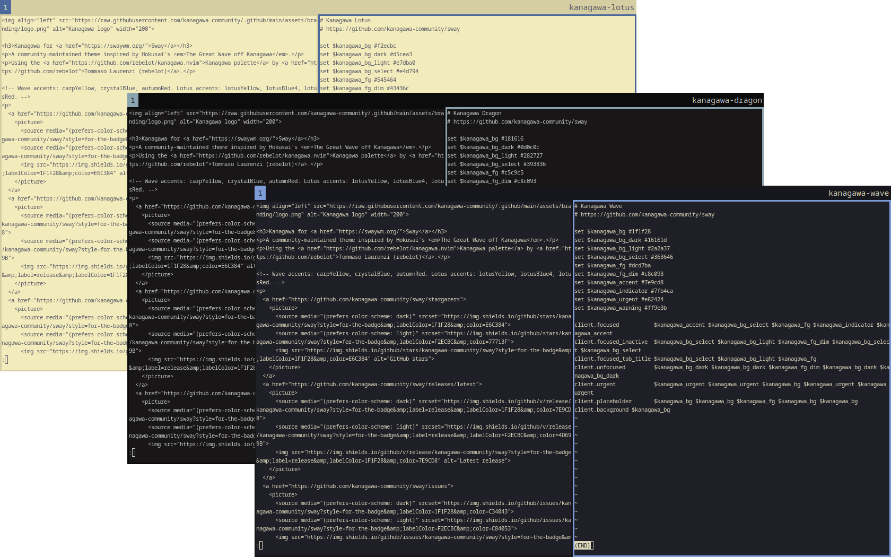
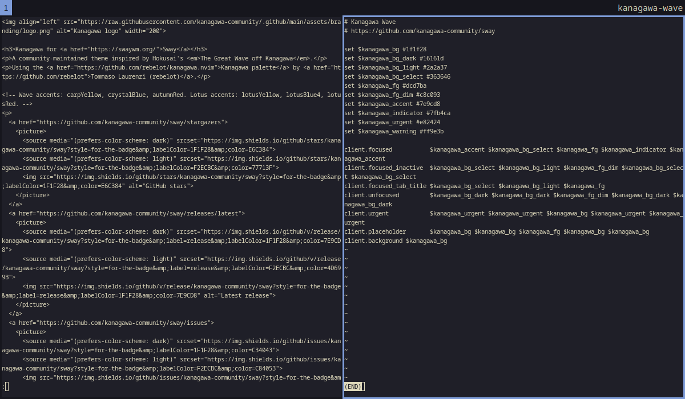
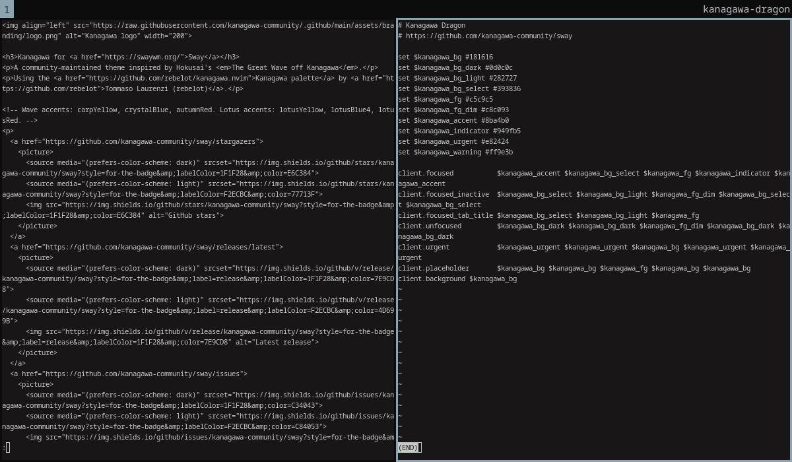
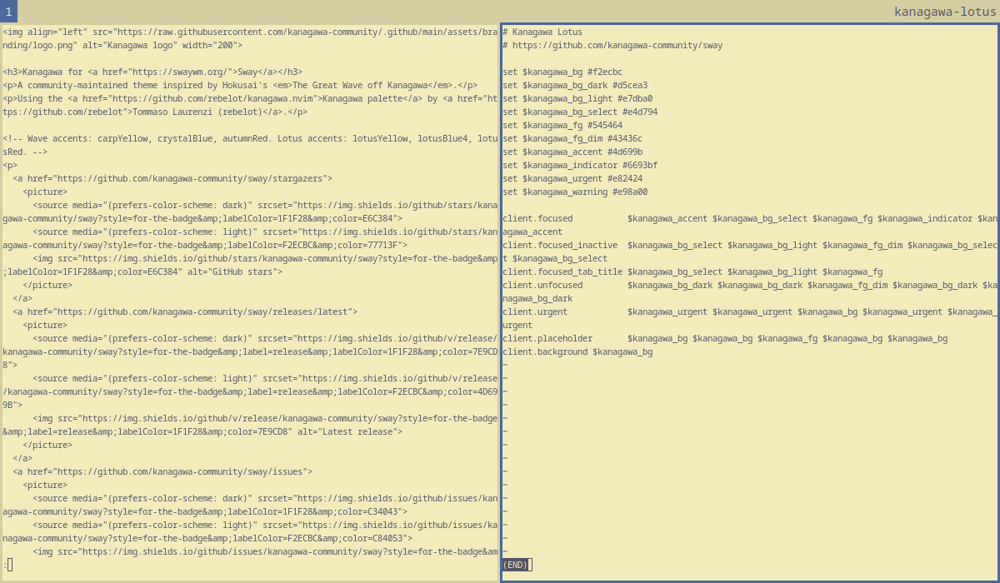

<h3>Kanagawa for <a href="https://swaywm.org/">Sway</a></h3>
<p>A community-maintained theme inspired by Hokusai's <em>The Great Wave off Kanagawa</em>.</p>
<p>Using the <a href="https://github.com/rebelot/kanagawa.nvim">Kanagawa palette</a> by <a href="https://github.com/rebelot">Tommaso Laurenzi (rebelot)</a>.</p>

<!-- Wave accents: carpYellow, crystalBlue, autumnRed. Lotus accents: lotusYellow, lotusBlue4, lotusRed. -->
<p>
  <a href="https://github.com/kanagawa-community/sway/stargazers">
    <picture>
      <source media="(prefers-color-scheme: dark)" srcset="https://img.shields.io/github/stars/kanagawa-community/sway?style=for-the-badge&amp;labelColor=1F1F28&amp;color=E6C384">
      <source media="(prefers-color-scheme: light)" srcset="https://img.shields.io/github/stars/kanagawa-community/sway?style=for-the-badge&amp;labelColor=F2ECBC&amp;color=77713F">
      
    </picture>
  </a>
  <a href="https://github.com/kanagawa-community/sway/releases/latest">
    <picture>
      <source media="(prefers-color-scheme: dark)" srcset="https://img.shields.io/github/v/release/kanagawa-community/sway?style=for-the-badge&amp;label=release&amp;labelColor=1F1F28&amp;color=7E9CD8">
      <source media="(prefers-color-scheme: light)" srcset="https://img.shields.io/github/v/release/kanagawa-community/sway?style=for-the-badge&amp;label=release&amp;labelColor=F2ECBC&amp;color=4D699B">
      
    </picture>
  </a>
  <a href="https://github.com/kanagawa-community/sway/issues">
    <picture>
      <source media="(prefers-color-scheme: dark)" srcset="https://img.shields.io/github/issues/kanagawa-community/sway?style=for-the-badge&amp;labelColor=1F1F28&amp;color=C34043">
      <source media="(prefers-color-scheme: light)" srcset="https://img.shields.io/github/issues/kanagawa-community/sway?style=for-the-badge&amp;labelColor=F2ECBC&amp;color=C84053">
      
    </picture>
  </a>
</p>

<br clear="both">
<br>

## Previews



<details>
<summary>🌊 Wave</summary>

</details>

<details>
<summary>🐉 Dragon</summary>

</details>

<details>
<summary>🪷 Lotus</summary>

</details>

## Requirements

- Sway 1.5 or later.

## Installation

Download the three themes into ~/.config/sway/themes:

```sh
mkdir -p ~/.config/sway/themes
for variant in wave dragon lotus; do
  curl -fsSL -o ~/.config/sway/themes/kanagawa-$variant https://raw.githubusercontent.com/kanagawa-community/sway/main/themes/kanagawa-$variant
done
```

Or clone the repository and run `./install.sh`. It installs all three variants,
or only the ones you name, for example `./install.sh dragon lotus`. `./uninstall.sh`
takes the same names and removes them.

## Usage

Include a theme in `~/.config/sway/config`, before any lines that use its
variables:

```conf
include ~/.config/sway/themes/kanagawa-wave
```

The theme sets the window colors and defines variables named by role, such as
`$kanagawa_bg` and `$kanagawa_accent`. Use them in your bar, for example:

```conf
bar {
    colors {
        background $kanagawa_bg_dark
        statusline $kanagawa_fg
        focused_workspace  $kanagawa_accent $kanagawa_accent $kanagawa_bg
        inactive_workspace $kanagawa_bg_dark $kanagawa_bg_dark $kanagawa_fg_dim
        urgent_workspace   $kanagawa_urgent $kanagawa_urgent $kanagawa_bg
    }
}
```

## Palette

Every color comes from the shared
[palette](https://github.com/kanagawa-community/.github/blob/main/docs/PALETTE.md),
picked by role, so each variant uses its own value for the same role.

| Sway color                                         | Palette role         |
| -------------------------------------------------- | -------------------- |
| `$kanagawa_bg`, `client.background`                | `ui.bg`              |
| `$kanagawa_bg_dark`, `client.unfocused`            | `ui.bg_m3`           |
| `$kanagawa_bg_light`                               | `ui.bg_p1`           |
| `$kanagawa_bg_select`, `client.focused` background | `ui.bg_p2`           |
| `$kanagawa_fg`, `$kanagawa_fg_dim`                 | `ui.fg`, `ui.fg_dim` |
| `$kanagawa_accent`, `client.focused` border        | `syn.fun`            |
| `$kanagawa_indicator`                              | `syn.special1`       |
| `$kanagawa_urgent`, `client.urgent`                | `diag.error`         |
| `$kanagawa_warning`                                | `diag.warning`       |

## Credits

This port replaces the Sway theme in the `extras` folder of the
[Neovim plugin](https://github.com/kanagawa-community/neovim). Sam Boysel first contributed that theme to kanagawa.nvim. The
colors come from [kanagawa.nvim](https://github.com/rebelot/kanagawa.nvim) by
Tommaso Laurenzi.

## Issues and contributions

Report bugs and request changes in this port's
[issue tracker](https://github.com/kanagawa-community/sway/issues). Contributions are welcome.

See [CONTRIBUTING.md](CONTRIBUTING.md) before opening a pull request.

## License

MIT. See [LICENSE](LICENSE).
